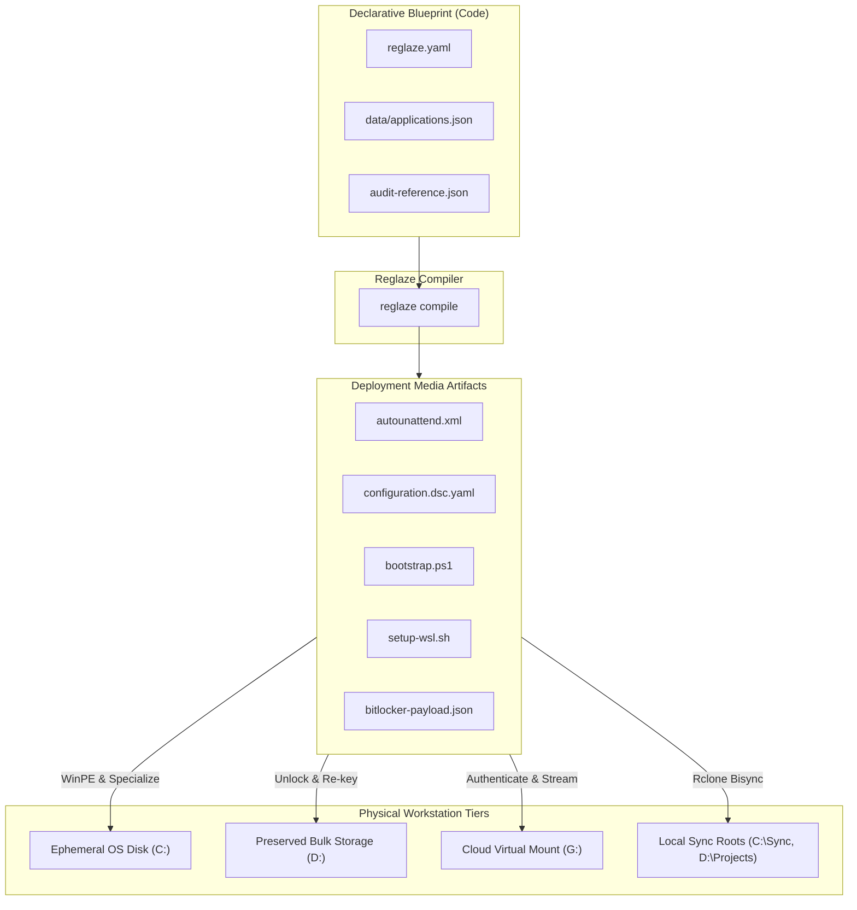
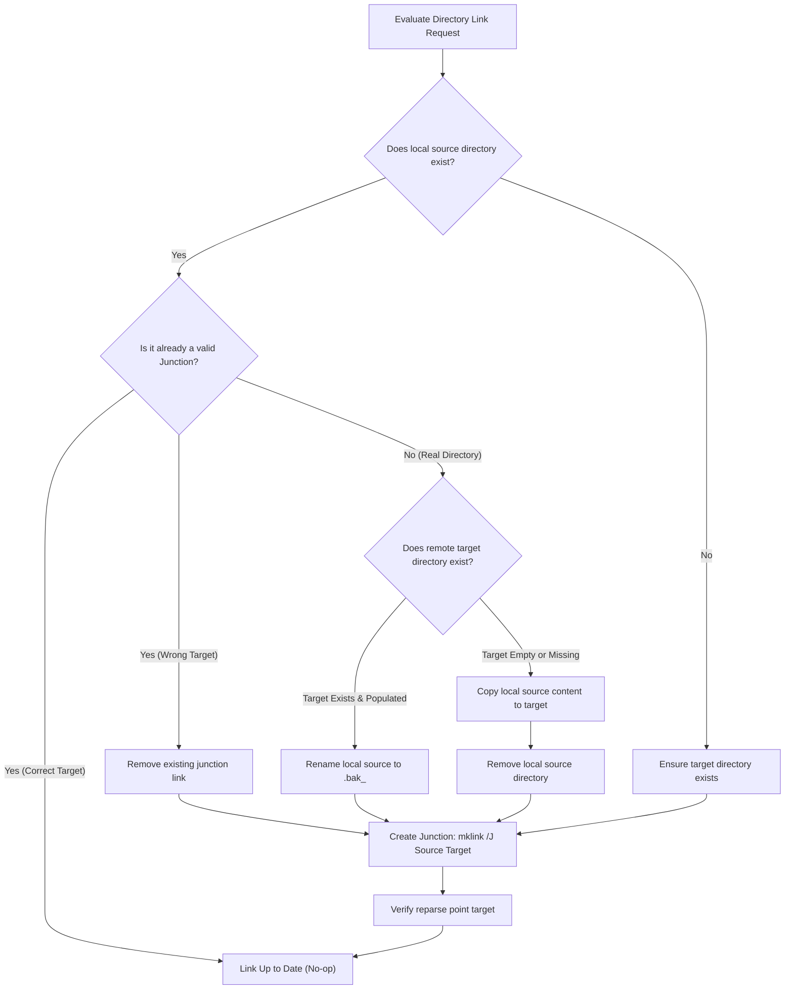
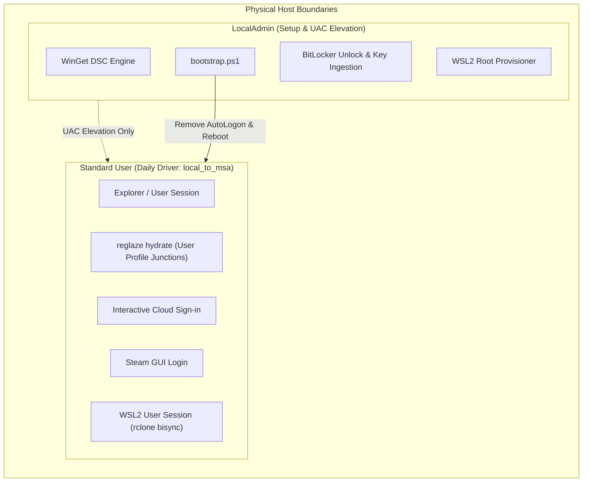
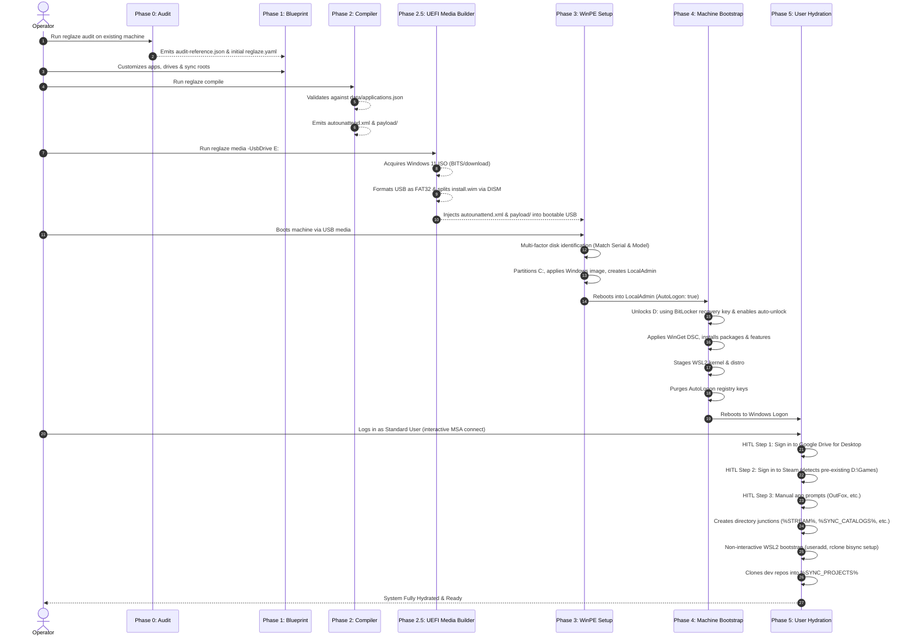
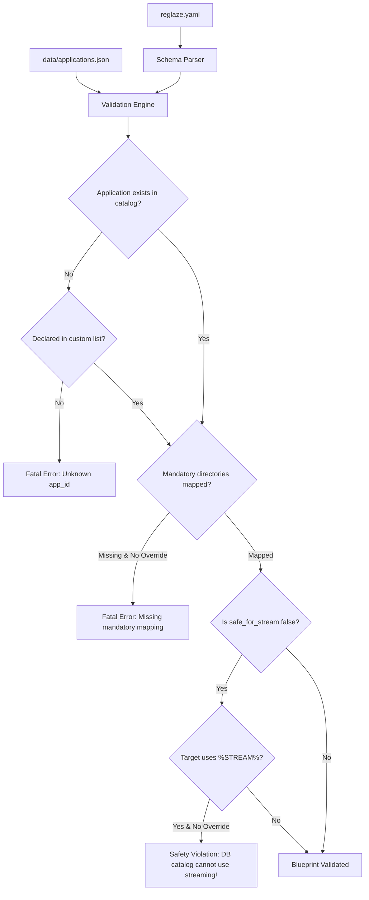
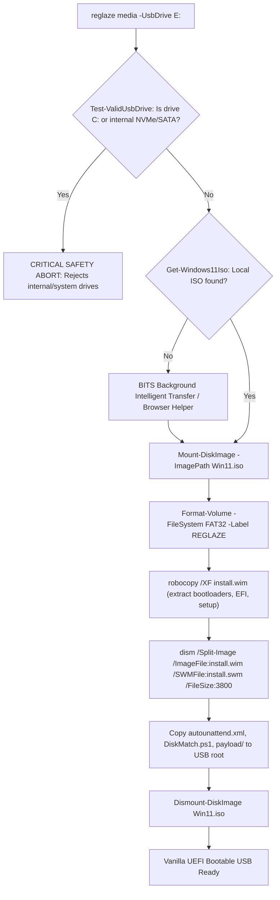
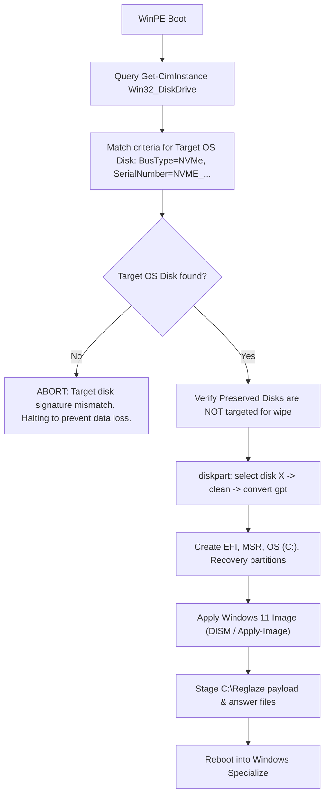
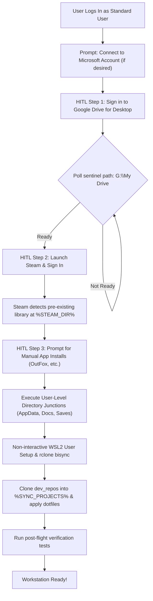

# Reglaze: System Architecture & Technical Design Specification

| Document Metadata | Details |
| :--- | :--- |
| **Project** | `reglaze` |
| **Title** | System Architecture & Technical Design Specification |
| **Status** | Approved Baseline |
| **Version** | 1.0.0 |
| **Target Platforms** | Windows 11 Pro / Enterprise (x64, ARM64) |
| **Author / Architect** | Antigravity Engine & Kirk Haines |

---

## 1. Executive Summary & Vision

### 1.1 The Problem
Traditional personal workstation maintenance treats operating system installations as precious, bespoke artifacts ("pets"). Over months and years, Windows installations accumulate registry fragmentation, unmanaged dependencies, inconsistent environment variables, orphaned background services, and undocumented customizations. When a catastrophic hardware failure occurs or performance degrades, rebuilding the workstation requires days of manual installation, credential recovery, application re-configuration, and directory linking.

### 1.2 The Solution: Declarative, Disposable Workstations ("Cattle, Not Pets")
`reglaze` transforms Windows workstations into fully disposable, immutable computing nodes defined entirely by code (Infrastructure as Code - IaC). With `reglaze`, a developer or creative professional can treat their Windows OS drive as completely ephemeral:

$$\text{Bare Metal} \xrightarrow[\text{Automated Deployment}]{\text{< 60 Minutes}} \text{Fully Hydrated, Identical Production Workstation}$$

All configuration, application state, credentials, developer repositories, and game libraries are externalized into decoupled storage tiers. Operating system reinstallation ceases to be an ordeal; it becomes a routine, low-stress operational procedure.



---

## 2. Core Architecture Principles

1. **Declarative Single Source of Truth**: The complete machine state is defined in `reglaze.yaml` validated against the reference catalog `data/applications.json`.
2. **Strict Tiered Storage Decoupling**: File types are routed to storage tiers matched to their performance, locking semantics, and size requirements.
3. **Dual-User Security Partitioning**: Administrative provisioning runs under a dedicated `LocalAdmin` account; daily operations execute under a standard non-administrator account linked to a Microsoft Account.
4. **Resilient Hardware Disambiguation**: Physical storage drives are matched using multi-factor hardware attributes (Serial Number, Bus Type, Model, Size), never volatile disk indices (`Disk 0`).
5. **Human-in-the-Loop (HITL) Staging**: Automated phases execute to the maximum extent possible before clustering interactive steps (Cloud authentication, Steam Guard, manual setup) to prevent user alert fatigue.
6. **Non-Destructive Idempotency**: Directory junction creation, package installations, and sync configurations can be executed repeatedly without data loss or duplicate state.

---

## 3. Tiered Storage Model & Linking Strategy

A critical failure mode of previous cloud workstation frameworks is routing database-backed applications (e.g., Lightroom, Darktable) or active Git repositories to cloud streaming virtual file systems (such as Google Drive for Desktop's virtual `G:` drive). Streaming mounts lack POSIX file-locking semantics, drop SQLite journal locks, and introduce high network I/O latency, causing catalog corruption and crashed processes.

`reglaze` formalizes a **4-Tier Storage Topology**:

| Tier | Name | Storage Medium | Characteristics & Usage | Example Paths |
| :--- | :--- | :--- | :--- | :--- |
| **Tier 1** | **Ephemeral OS** | Primary NVMe SSD (`C:`) | Completely disposable. Wiped during installation. Hosts OS binaries, `AppData\Local` caches, temporary files, and system pagefiles. | `C:\Windows`, `C:\Program Files` |
| **Tier 2** | **Cloud-Streamed Virtual Mount** | Virtual File System Mount (`G:\My Drive`) | Real-time on-demand cloud streaming. Ideal for flat text configs, VS Code settings, game saves, and media assets that tolerate virtual file system semantics. | `G:\My Drive\Config\VSCode`, `G:\My Drive\Backups\Saves` |
| **Tier 3** | **Cloud-Synced Local Roots** | High-Speed Local NVMe (`C:\Sync`, `D:\Projects`) | True local NTFS storage with POSIX/NTFS file locks and native NVMe I/O speed. Backed up to cloud asynchronously via bidirectional sync (`rclone bisync`). Required for SQLite catalogs and Git repos. | `C:\Sync\Catalogs\Lightroom`, `D:\Projects\reglaze` |
| **Tier 4** | **Preserved Secondary Storage** | Dedicated Local NVMe/SSD (`D:`) | Massive local disk preserved across OS reinstallations. Holds raw video footage, Steam games, virtual machine disks. Excluded from OS wipe. | `D:\Games\Steam`, `D:\VirtualMachines` |

### 3.1 Junction Mechanics (`mklink /J`)
`reglaze` exclusively utilizes **NTFS Directory Junctions** (`mklink /J`) rather than directory symbolic links (`mklink /D`):
* **No Developer Mode Required**: Creating directory junctions does not require Windows Developer Mode or elevated UAC privileges during user hydration.
* **Kernel-Level Transparent Redirection**: Directory junctions operate at the NTFS file system filter driver layer (`IO_REPARSE_TAG_MOUNT_POINT`), presenting as local directories to legacy Win32, .NET, and UWP applications.
* **Hard Boundary Enforcement**: Directory junctions only target local file system namespaces (e.g. `C:\`, `D:\`, `G:\`), preventing network loopback issues.

### 3.2 Directory Collision & Hydration Strategy
When establishing junction links during user hydration, the linking engine follows an atomic, non-destructive state machine:



### 3.3 Variable Placeholders & Token Resolution
To decouple blueprints from physical machine drive topologies, all directory paths in `reglaze.yaml` and `data/applications.json` use standardized variable placeholders:

| Variable Placeholder | Definition & Resolution Rule | Example Value |
| :--- | :--- | :--- |
| `%OS_DRIVE%` | Resolves to the letter of the target OS installation volume. | `C:` |
| `%DATA_DRIVE%` | Resolves to the letter of the primary preserved secondary disk. | `D:` |
| `%STREAM%` | Resolves to the verified cloud streaming sentinel root. | `G:\My Drive` |
| `%SYNC_<ID>%` | Resolves to the local path of a declared sync root (e.g., `storage.sync.directories.<id>`). | `C:\Sync\Catalogs`, `D:\Projects` |
| `%<CUSTOM_VAR>%` | Resolves to any custom path shortcut declared in `variables:` (e.g., `STEAM_DIR`). | `D:\SteamLibrary` |

> [!IMPORTANT]
> **Syntax Standardization:** All variable placeholders strictly use the underscore format (e.g., `%SYNC_CATALOGS%`, `%SYNC_PROJECTS%`). The colon format (such as `%SYNC:catalogs%`) is explicitly rejected by the schema validator.

### 3.4 Dotfile & Configuration Management via Chezmoi (Git-Optional)

While Chezmoi is frequently paired with remote Git repositories, **Chezmoi operates on local directory trees and does not require Git**. `reglaze` supports running Chezmoi directly against storage backends provisioned in Google Drive:

1. **Decoupled Source Directory**:
   - The Chezmoi source state can reside directly within the cloud streaming tier (`%STREAM%\Config\chezmoi`) or within a local sync root (`%SYNC_PROJECTS%\dotfiles`).
   - Invocation does not require cloning a repository; it reads the source directory directly:
     ```powershell
     chezmoi apply --source "$env:STREAM\Config\chezmoi"
     ```
   - Alternatively, a lightweight `~/.config/chezmoi/chezmoi.toml` can be provisioned by `reglaze` pointing to the source directory:
     ```toml
     sourceDir = "G:/My Drive/Config/chezmoi"
     ```

2. **App-Specific Config Reading & Writing (`modify_` scripts)**:
   - For applications with complex configuration files (e.g. `UserPreferences.ini`, `settings.json`, XML configs) where overwriting the entire file would destroy dynamic runtime state or machine-specific tokens, Chezmoi supports **`modify_` scripts**.
   - A `modify_<filename>.ps1` script receives the existing target file on standard input (`stdin`), executes programmatic transformations (e.g., updating specific INI keys, merging JSON fragments, or toggling XML attributes), and emits the modified content on standard output (`stdout`).
   - If the target file does not yet exist on disk, Chezmoi provides an empty stream or default template to the script.

3. **Lifecycle Script Execution (`run_` scripts)**:
   - **`run_once_`**: Executes once per machine (e.g. installing CLI extensions, setting one-time registry keys).
   - **`run_onchange_`**: Re-executes whenever an accompanying configuration file changes (e.g. hashing a plugins list and running an installer when the hash changes).
   - **`run_after_`**: Executes after configuration files are written (e.g. reloading daemon settings or restarting an agent).

---

## 4. Security, Secrets & Threat Model

### 4.1 Threat Model & Security Boundaries



1. **Principle of Least Privilege**:
   - The primary user is created as a **standard non-administrator user** (`is_admin: false`).
   - Daily activities, web browsing, developer tasks, and gaming run entirely without administrative rights.
   - UAC elevation requires entering credentials for the distinct `LocalAdmin` account.
2. **Ephemeral Auto-Logon Lifecycle**:
   - Auto-logon is enabled **exclusively** for `LocalAdmin` during initial WinPE/Specialize provisioning to execute machine setup (`bootstrap.ps1`).
   - The final task of `bootstrap.ps1` purges auto-logon credentials from `HKLM:\SOFTWARE\Microsoft\Windows NT\CurrentVersion\Winlogon` (`DefaultUserName`, `DefaultPassword`, `AutoAdminLogon`).
   - Subsequent boots present the standard Windows lock screen.
3. **No Secrets in Version Control**:
   - `reglaze.yaml` and `audit-reference.json` contain references to environment variables (e.g. `password_env: "LOCAL_ADMIN_PASSWORD"`, `client_id_env: "GDRIVE_CLIENT_ID"`).
   - The compiler pulls credentials from the local host environment during media compilation.
   - Root `reglaze.yaml`, `audit-reference.json`, `dist/`, and recovery payloads are listed in `.gitignore`.
4. **Preserved Disk BitLocker Recovery Pipeline**:
   - Preserved secondary disks (`D:`) are protected by BitLocker with TPM + Recovery Password protectors.
   - Wiping `C:` breaks the TPM auto-unlock relationship for `D:`.
   - During `reglaze compile`, the recovery key for `D:` harvested in `audit-reference.json` is packaged into a protected payload file on the installation media (`payload\bitlocker-keys.json`).
   - During Phase 4, `bootstrap.ps1` runs under `LocalAdmin`:
     ```powershell
     Unlock-BitLocker -MountPoint "D:" -RecoveryPassword $RecoveredKey
     Enable-BitLockerAutoUnlock -MountPoint "D:"
     ```
   - This restores seamless auto-unlock for the preserved volume without exposing the key on unencrypted secondary drives.

---

## 5. End-to-End System Lifecycle (The 6 Phases)

The complete lifecycle of a `reglaze` workstation consists of six discrete phases:



---

### Phase 0: Pre-Flight Discovery & Machine Audit (`reglaze audit`)

The audit engine runs non-destructively on the existing running Windows installation. It collects hardware signatures, licensing data, and file system relationships.

#### Multi-Factor Storage Signature Discovery
To eliminate catastrophic data loss caused by non-deterministic disk ordering in WinPE (where USB drives or NVMe bus scans can cause `Disk 0` to become `Disk 1`), the audit records immutable hardware identifiers:

```powershell
Get-CimInstance Win32_DiskDrive | Select-Object `
    DeviceID, Index, Model, SerialNumber, InterfaceType, Size, `
    @{Name="BusType"; Expression={(Get-PhysicalDisk -DeviceNumber $_.Index).BusType}}, `
    @{Name="UniqueId"; Expression={(Get-PhysicalDisk -DeviceNumber $_.Index).UniqueId}}
```

#### BitLocker Recovery Key Extraction
For every volume protected by BitLocker:
```powershell
Get-BitLockerVolume | ForEach-Object {
    $vol = $_
    $recoveryKey = $vol.KeyProtector | Where-Object { $_.KeyProtectorType -eq 'RecoveryPassword' }
    [PSCustomObject]@{
        MountPoint       = $vol.MountPoint
        VolumeType       = $vol.VolumeType
        EncryptionMethod = $vol.EncryptionMethod
        RecoveryPassword = $recoveryKey.RecoveryPassword
        RecoveryKeyId    = $recoveryKey.KeyProtectorId
    }
}
```

#### Dual Application Discovery: WinGet + Add/Remove Programs (ARP)
WinGet manifests only cover software distributed through the Windows Package Manager. To detect manually installed applications, standalone software, and older installers (InnoSetup, NSIS, InstallShield, MSI), `audit.ps1` executes a comprehensive registry harvest across three distinct hives:
1. **64-bit Machine-Wide**: `HKLM:\SOFTWARE\Microsoft\Windows\CurrentVersion\Uninstall\*`
2. **32-bit WoW64 Machine-Wide**: `HKLM:\SOFTWARE\WOW6432Node\Microsoft\Windows\CurrentVersion\Uninstall\*`
3. **Current User (Per-User Installs)**: `HKCU:\SOFTWARE\Microsoft\Windows\CurrentVersion\Uninstall\*`

The audit module:
- Extracts `DisplayName`, `DisplayVersion`, `Publisher`, `InstallLocation`, `InstallDate`, and `UninstallString`.
- Filters out OS updates, hotfixes, and language packs (`SystemComponent -ne 1`, `ParentKeyName -eq $null`).
- De-duplicates items already tracked by WinGet.
- Cross-references remaining applications against the `data/applications/` catalog using normalized names and fuzzy publisher matching.
- Emits unmatched applications into `detected_non_winget_applications` in `audit-reference.json`, allowing the user to easily identify and transition manual software into `custom:` or new `data/applications/<app_id>` definitions.

#### Windows Preferences & System Settings Discovery
The pre-flight audit executes `data/windows/audit-windows-settings.ps1` to capture current environment configurations:
- **File Explorer**: Hidden file visibility (`Hidden`), file extension display (`HideFileExt`), navigation target (`LaunchTo`).
- **Taskbar & Tray**: Taskbar alignment (`TaskbarAl`), search display mode (`SearchboxTaskbarMode`), widgets (`TaskbarDa`), and system tray icon visibility.
- **Power & Performance**: Active power scheme GUID and display/sleep timeouts (`powercfg`).

#### Pre-Flight Output Artifacts
1. `audit-reference.json`: The machine hardware, cryptographic profile, installed WinGet packages, non-WinGet ARP software, and detected Windows settings.
2. `reglaze.yaml`: Pre-populated skeleton blueprint reflecting detected packages, junction mappings, and storage options.

---

### Phase 1: Blueprint Specification & Validation (`reglaze validate`)

The operator configures `reglaze.yaml`. The compiler runs comprehensive semantic and safety validation against `data/applications.json`:



#### Core Validation Rules:
1. **Catalog Integrity**: Any application declared under `applications` must match an `app_id` in `data/applications.json`. Uncataloged applications must reside in `custom`.
2. **Mandatory Mapping Enforcement**: If `needs_mapping: true` in the catalog, `reglaze.yaml` must provide a `target` path or an explicit `override: { action: "omit" }`.
3. **Safety Protection**: If `safe_for_stream: false` in the catalog, specifying a target that resolves to `%STREAM%` fails compilation unless overridden with `override: { action: "force_stream", reason: "..." }`.
4. **Variable Verification**: All `%SYNC_<ID>%` tokens must resolve to a valid entry under `storage.sync.directories`.

---

### Phase 2: Compiler & Media Artifact Generation (`reglaze compile`)

The compiler merges `reglaze.yaml`, `audit-reference.json`, and `data/applications.json` into deployment artifacts:

```
dist/media/
├── autounattend.xml               # WinPE partitioning & specialize answer file
├── payload/
│   ├── configuration.dsc.yaml     # WinGet DSC manifest
│   ├── bitlocker-keys.json        # Encrypted secondary volume recovery keys
│   ├── junctions-manifest.json    # Pre-computed junction mapping table
│   ├── bootstrap.ps1              # Machine provisioning runner (LocalAdmin)
│   ├── hydrate.ps1                # User hydration runner (Standard User)
│   ├── setup-wsl.sh               # WSL2 non-interactive provisioner
│   └── applications.json          # Cached reference catalog
└── EFI/boot/                      # Windows Setup bootloader
```

#### `autounattend.xml` Architecture
* **`windowsPE` Pass**: Executes WinPE pre-installation script to identify the target OS disk using multi-factor criteria. Partitions the drive into EFI (100MB), MSR (16MB), Windows OS (NTFS), and Recovery (1000MB).
* **`specialize` Pass**: Sets computer name, timezone, product key from `audit-reference.json`, and enables base features (`Microsoft-Windows-Subsystem-Linux`, `VirtualMachinePlatform`).
* **`oobeSystem` Pass**: Creates `LocalAdmin` and the standard user (`local_to_msa`). Sets `AutoLogon` for `LocalAdmin` with `LogonCount: 1`. Directs `FirstLogonCommands` to launch `C:\Reglaze\bootstrap.ps1`.

---

### Phase 2.5: Official Windows 11 ISO Acquisition & Native UEFI Bootable Media Creation (`reglaze media`, `reglaze iso`)

To eliminate reliance on fragile third-party flashing utilities (Rufus, Ventoy) and avoid the manual multi-step Microsoft Media Creation Tool (MCT) GUI wizard, `reglaze` provides a native, 100% Microsoft-compliant UEFI bootable USB flashing engine.

#### 1. Why Native UEFI FAT32 with DISM Split-Wim?
* **Universal UEFI Boot Compatibility**: UEFI firmware implementations across modern motherboards natively support booting from FAT32 partitions. Formatting the USB drive as FAT32 ensures zero firmware incompatibilities across AMD and Intel platforms.
* **The 4GB FAT32 Limitation**: Modern Windows 11 installation ISOs contain an `install.wim` file that exceeds FAT32's 4GB file size limit (often 4.8 GB – 5.5 GB).
* **Native DISM Image Splitting**: Third-party tools often work around this limit by creating complex dual-partition drives or NTFS bootloaders requiring custom UEFI drivers (UEFI:NTFS). Instead, `reglaze` uses Windows' built-in DISM command:
  ```cmd
  dism.exe /Split-Image /ImageFile:"D:\sources\install.wim" /SWMFile:"E:\sources\install.swm" /FileSize:3800
  ```
  Windows Setup natively recognizes split `.swm` files (`install.swm`, `install2.swm`) out of the box without requiring any registry hacks, modified bootloaders, or bypass scripts.
* **Preserving Annual Windows Feature Updates**: Flashing tools like Rufus often inject setup-time registry bypasses (bypassing TPM 2.0, Secure Boot, or CPU requirements). These registry hacks frequently break subsequent major Windows feature updates (e.g. 23H2 &rarr; 24H2). `reglaze` produces completely vanilla, standard installation media that satisfies all native Windows servicing pipelines.

#### 2. Workflow & Step-by-Step Execution:


#### 3. Strict Safety Guardrails (`Test-ValidUsbDrive`):
Before issuing any formatting command, `Test-ValidUsbDrive` inspects physical disk topology using CIM and storage cmdlets:
1. **System Drive Protection**: Evaluates drive letter against `$env:SystemDrive` and strictly rejects `C:` with a fatal error.
2. **Fixed Internal Disk Protection**: Queries `(Get-Disk).BusType` and `(Get-Disk).IsRemovable`. If the drive is located on an internal NVMe, SATA, or RAID bus (`BusType -ne 'USB'`), formatting is rejected unless `-Force` is explicitly passed.

#### 4. ISO Acquisition Engine (`Get-WindowsIso.ps1`):
* **Local Discovery**: Scans working directories, `./downloads/`, and standard user `Downloads` folders for existing official ISOs (`Win11*.iso` > 3GB).
* **Automated BITS Transfer**: If a direct URL is supplied or available, uses Background Intelligent Transfer Service (`Start-BitsTransfer`) with pause/resume support.
* **Interactive Browser Helper**: If manual download is preferred (`-OpenBrowser`), opens the official Microsoft software download portal (`https://www.microsoft.com/software-download/windows11`) and monitors the target directory with active file-lock polling until download completion.

---

### Phase 3: Automated OS Deployment (WinPE & Specialize)

When booting from the generated media, WinPE executes the **Dynamic Disk Matching Engine** before diskpart executes:



```powershell
# WinPE Pre-Install Disk Resolution Logic
$TargetSerial = "NVME_DISK_0001_SAMPLE"
$TargetBus = "NVMe"

$Disks = Get-PhysicalDisk
$TargetDisk = $Disks | Where-Object { 
    $_.SerialNumber -eq $TargetSerial -and $_.BusType -eq $TargetBus 
}

if (-not $TargetDisk) {
    Write-Error "CRITICAL: Could not uniquely match target OS disk! Halting installation."
    Exit 1
}

$DiskNumber = $TargetDisk.DeviceId
# Generate dynamic diskpart script selecting $DiskNumber
```

---

### Phase 4: Post-Install Machine Orchestration (`bootstrap.ps1` under LocalAdmin)

Upon initial boot, Windows automatically logs into `LocalAdmin`. `bootstrap.ps1` executes non-interactively in strict sequence:

```powershell
# 1. Unlock & Re-arm Preserved BitLocker Volumes
$BitLockerPayload = Get-Content "C:\Reglaze\payload\bitlocker-keys.json" | ConvertFrom-Json
foreach ($Vol in $BitLockerPayload) {
    if ($Vol.MountPoint -ne "C:") {
        Unlock-BitLocker -MountPoint $Vol.MountPoint -RecoveryPassword $Vol.RecoveryPassword
        Enable-BitLockerAutoUnlock -MountPoint $Vol.MountPoint
    }
}

# 2. Automated WHQL Driver Servicing (Chipset, Audio, Network, Storage)
# Executes prior to application installation so all hardware is natively operational
if ($Blueprint.system.updates.drivers -ne $false) {
    Install-PackageProvider -Name NuGet -Force -Scope CurrentUser
    Install-Module -Name PSWindowsUpdate -Force -Scope CurrentUser
    Get-WindowsUpdate -Category "Drivers" -Install -AcceptAll -IgnoreReboot -ErrorAction SilentlyContinue
}

# 3. General Windows Quality & Security Update Pass
# Pulls latest cumulative updates and security patches before software packages are staged
if ($Blueprint.system.updates.windows_updates -ne $false) {
    Get-WindowsUpdate -NotCategory "Drivers" -Install -AcceptAll -IgnoreReboot -ErrorAction SilentlyContinue
}

# 4. Execute WinGet DSC Configuration (Machine Scope Application Deployment)
winget configure --file "C:\Reglaze\payload\configuration.dsc.yaml" --accept-configuration-agreements --disable-interactivity

# 5. Stage WSL2 Base Kernel and Linux Distribution
wsl --install -d Ubuntu --no-launch

# 6. Create Machine-Level Junctions (Program Files, Common Assets)
# Executes any system-level junctions declared in junctions-manifest.json

# 7. Destroy AutoLogon Credentials
Remove-ItemProperty -Path "HKLM:\SOFTWARE\Microsoft\Windows NT\CurrentVersion\Winlogon" -Name "DefaultPassword" -ErrorAction SilentlyContinue
Set-ItemProperty -Path "HKLM:\SOFTWARE\Microsoft\Windows NT\CurrentVersion\Winlogon" -Name "AutoAdminLogon" -Value "0"

# 8. Schedule Phase 5 Hydration on User Logon & Restart
Set-ItemProperty -Path "HKLM:\SOFTWARE\Microsoft\Windows\CurrentVersion\RunOnce" -Name "ReglazeHydrate" -Value "powershell.exe -ExecutionPolicy Bypass -File C:\Reglaze\payload\hydrate.ps1"
Restart-Computer -Force
```

---

### Phase 5: User & Application Hydration (Standard User Session)

The operator logs in as the primary standard user. `hydrate.ps1` starts automatically and executes the staged orchestration:



#### Staged Human-in-the-Loop (HITL) Execution
To prevent overwhelming the user with simultaneous dialogs, interactive tasks are strictly sequenced:
1. **Cloud Virtual Mount Sign-in**: The runner launches `GoogleDriveFS.exe` and monitors for the sentinel path (`G:\My Drive`). Once verified, Phase 5 unlocks cloud-streamed junction targets.
2. **Steam Sign-in**: Steam launches to allow GUI login and Steam Guard verification. Because games are already present on `%DATA_DRIVE%\SteamLibrary`, Steam instantly rediscovers all games without multi-gigabyte re-downloads.
3. **Manual App Installations**: For apps flagged with `"install": { "method": "manual" }` (such as OutFox), `reglaze` displays an interactive dialog showing the official download URL, recommended target path, and instructions.

#### Non-Interactive WSL2 Provisioning
To avoid interactive UNIX prompts (`Enter new UNIX username:`) halting the pipeline, WSL2 is provisioned by injecting commands directly through `root`:

```powershell
# Executed by hydrate.ps1 on the host
$Distro = "Ubuntu"
$WSLUser = "developer"

# Run non-interactive setup as root inside WSL2
wsl.exe -d $Distro -u root -- /bin/bash -c @"
set -e
# Create user if not present
if ! id -u $WSLUser >/dev/null 2>&1; then
    useradd -m -s /bin/bash -G sudo $WSLUser
    echo '$WSLUser ALL=(ALL) NOPASSWD:ALL' > /etc/sudoers.d/99-$WSLUser
fi

# Configure rclone bisync
mkdir -p /home/$WSLUser/.config/rclone
cat << 'EOF' > /home/$WSLUser/.config/rclone/rclone.conf
[gdrive]
type = drive
client_id = $Env:GDRIVE_CLIENT_ID
client_secret = $Env:GDRIVE_CLIENT_SECRET
scope = drive
EOF
chown -R $WSLUser:$WSLUser /home/$WSLUser/.config

# Stage and run initial rclone bisync
su - $WSLUser -c 'rclone bisync gdrive:dev_repos /home/$WSLUser/dev_repos --resync --create-empty-src-dirs'
"@
```

#### HITL State Resumption, Checkpoints & Desktop Shortcut

To ensure a seamless user experience even if the operator is interrupted, exits the terminal, or experiences a reboot:

1. **State Tracking & Checkpoints (`hydration-state.json`)**:
   - `hydrate.ps1` maintains an idempotent state file at `%LOCALAPPDATA%\Reglaze\hydration-state.json`.
   - Each completed milestone records a timestamped checkpoint:
     ```json
     {
       "msa_connected": true,
       "cloud_stream_authenticated": true,
       "steam_library_connected": true,
       "manual_apps_installed": ["outfox"],
       "junctions_established": true,
       "wsl_provisioned": true,
       "dev_repos_cloned": false,
       "completed": false
     }
     ```
   - When launched, `hydrate.ps1` checks this state file. Completed milestones are validated and skipped, allowing the operator to resume exactly where they left off.

2. **Automatic Startup & Self-Unregistration**:
   - At the conclusion of Phase 4, the installer registers `hydrate.ps1` in the standard user's startup registry key:
     `HKCU:\SOFTWARE\Microsoft\Windows\CurrentVersion\Run\ReglazeHydrate`
   - When the final milestone completes (`completed: true`), `hydrate.ps1` **automatically unregisters itself**:
     ```powershell
     Remove-ItemProperty -Path "HKCU:\SOFTWARE\Microsoft\Windows\CurrentVersion\Run" -Name "ReglazeHydrate" -ErrorAction SilentlyContinue
     ```
   - Subsequent user logins boot directly into a clean, unencumbered Windows desktop.

3. **Visible Desktop Resumption Shortcut**:
   - During initial user session initialization, a prominent shortcut is placed on the operator's desktop:
     `%USERPROFILE%\Desktop\Resume Reglaze Setup.lnk`
     pointing to:
     `powershell.exe -ExecutionPolicy Bypass -NoExit -File C:\Reglaze\payload\hydrate.ps1`
   - If the operator closes the terminal or needs to pause setup, they can simply double-click this desktop shortcut to resume at any time.
   - Upon final completion, the script renames the shortcut to `Reglaze Health Check.lnk` to provide a 1-click diagnostic tool for verifying ongoing junction and sync health.

---

## 6. Component Architecture & CLI Interface

The `reglaze` framework is implemented as an extensible PowerShell 7+ engine with a standardized CLI command suite and modular catalog architecture:

```
reglaze/
├── bin/
│   └── reglaze.ps1                # Main CLI wrapper script
├── data/
│   ├── applications/              # Modular Application Catalog (one directory per app_id)
│   │   ├── _schema.json           # Formal JSON Schema for individual app manifests
│   │   ├── _template/             # Starter template for adding new applications
│   │   │   ├── app.json
│   │   │   ├── guide.md
│   │   │   └── post-install.ps1
│   │   ├── adobe_lightroom/
│   │   │   └── app.json
│   │   ├── outfox/
│   │   │   ├── app.json
│   │   │   ├── guide.md           # Interactive manual install instructions
│   │   │   └── post-install.ps1   # Post-install shortcuts and path configuration
│   │   ├── vscode/
│   │   │   ├── app.json
│   │   │   └── post-install.ps1   # Extension initialization
│   │   └── ... (beat_saber, steam, lotro, git, etc.)
│   ├── windows/                   # Modular Windows Settings & Preferences
│   │   ├── explorer-folder-options.ps1  # Show hidden files, extensions, launch to This PC
│   │   ├── taskbar-system-tray.ps1      # Taskbar alignment, search mode, widget visibility
│   │   ├── performance-power.ps1        # Power scheme, sleep and monitor timeouts
│   │   └── audit-windows-settings.ps1   # Audits existing Windows settings for baseline
│   └── applications.json          # Merged/cached catalog index
├── src/
│   ├── audit/                     # Phase 0 Audit Engine
│   │   ├── Get-MachineHardware.ps1
│   │   ├── Get-BitLockerProfile.ps1
│   │   ├── Get-InstalledApplications.ps1 # Scans WinGet + Add/Remove Programs (ARP)
│   │   ├── Get-ExistingJunctions.ps1
│   │   └── Export-AuditBaseline.ps1
│   ├── compiler/                  # Phase 1 & 2 Compiler Engine
│   │   ├── Test-ReglazeSchema.ps1
│   │   ├── Resolve-Variables.ps1
│   │   ├── Build-Autounattend.ps1
│   │   ├── Build-WinGetDSC.ps1

│   │   └── Build-MediaPayload.ps1
│   ├── media/                     # Phase 2.5 UEFI Media Builder Engine
│   │   ├── Get-WindowsIso.ps1     # Official ISO discovery & BITS downloader
│   │   └── Build-Media.ps1        # Universal FAT32 builder with DISM split-wim
│   ├── common/                    # Shared Subsystems & Discovery
│   │   └── GameLibraries.ps1      # Multi-library game discovery & fresh install engine
│   ├── linking/                   # Junction & Redirection Engine
│   │   ├── New-DirectoryJunction.ps1
│   │   ├── Test-ReparsePoint.ps1
│   │   └── Backup-CollisionFolder.ps1
│   ├── runner/                    # Phase 4 & 5 Orchestration Runners
│   │   ├── Start-MachineBootstrap.ps1
│   │   ├── Start-UserHydration.ps1
│   │   └── Invoke-InteractiveWizard.ps1
│   └── wsl/                       # WSL2 Integration Subsystem
│       ├── Initialize-WSLDistro.ps1
│       └── Sync-WSLRclone.ps1
├── templates/
│   ├── autounattend.xml.template
│   ├── configuration.dsc.yaml.template
│   └── setup-wsl.sh.template
├── examples/
│   ├── audit-reference.json
│   └── reglaze.yaml
└── docs/
    └── ARCHITECTURE.md
```

### CLI Command Specifications

| CLI Command | Phase | Description |
| :--- | :--- | :--- |
| `reglaze audit` | Phase 0 | Performs pre-flight discovery of the current machine, producing `audit-reference.json` and a baseline `reglaze.yaml`. |
| `reglaze validate [-Config <path>]` | Phase 1 | Validates a blueprint against `data/applications.json`, checking syntax, mandatory mappings, and safety constraints. |
| `reglaze compile [-Config <path>] [-Output <path>]` | Phase 2 | Compiles declarative blueprint into installation media artifacts (`autounattend.xml`, DSC, scripts). |
| `reglaze build-media -DriveLetter <char>` | Phase 2 | Formats target USB drive and writes full installation media bundle with bootable WinPE image. |
| `reglaze bootstrap` | Phase 4 | Post-install machine provisioner run under `LocalAdmin` via `FirstLogonCommands`. |
| `reglaze hydrate` | Phase 5 | User-level hydration wizard run in standard user session to establish junctions, configure WSL, and clone repos. |
| `reglaze test [-VerifyAll]` | Post-Flight | Diagnostic test suite verifying all junctions, BitLocker statuses, WSL sync daemons, and drive mounts. |

---

## 7. Data Models & Schemas

### 7.1 `reglaze.yaml` Specification

```yaml
version: "1.0"
profile: "string"

system:
  computer_name: "string"
  os_edition: "string"
  timezone: "string"
  licensing:
    channel: "Retail | OEM | Volume"
    backup_key_reference: "audit-reference.json"
  users:
    local_admin:
      username: "LocalAdmin"
      password_env: "LOCAL_ADMIN_PASSWORD"
      auto_logon: true          # Only active during setup Phase 4
    primary_user:
      account_type: "local_to_msa | local | microsoft"
      email: "string"
      username: "string"
      is_admin: false           # Standard user
      auto_logon: false         # Daily interactive login
  features:
    developer_mode: bool
    virtual_machine_platform: bool
    subsystem_for_linux: bool

disks:
  target_os_disk:
    serial_number: "string"    # Hardware identifier from audit
    bus_type: "NVMe | SATA"
    wipe_and_partition: true
    drive_variable: "OS_DRIVE" # Exposes %OS_DRIVE%
  preserved_disks:
    - serial_number: "string"
      expected_mount: "D:"
      drive_variable: "DATA_DRIVE" # Exposes %DATA_DRIVE%
      label: "string"

storage:
  streaming:
    cloud_provider: "google-drive"
    mount_point: "G:"
    verify_folder: "G:\\My Drive"
    stream_variable: "STREAM"  # Exposes %STREAM%
  sync:
    provider: "google-drive-sync | rclone"
    directories:
      catalogs:
        local_path: "%OS_DRIVE%\\Sync\\Catalogs"
        cloud_folder: "Catalogs"
        verify_folder: "%OS_DRIVE%\\Sync\\Catalogs"
        sync_variable: "SYNC_CATALOGS" # Exposes %SYNC_CATALOGS%
      projects:
        local_path: "%DATA_DRIVE%\\Projects"
        cloud_folder: "Projects"
        sync_variable: "SYNC_PROJECTS" # Exposes %SYNC_PROJECTS%
  api_credentials:
    client_id_env: "GDRIVE_CLIENT_ID"
    client_secret_env: "GDRIVE_CLIENT_SECRET"

variables:
  GAMES_DIR: "%DATA_DRIVE%\\Games"
  STEAM_DIR: "%DATA_DRIVE%\\SteamLibrary"

applications:
  <app_id>:
    install: bool              # Optional: defaults to true
    directories:
      <directory_id>:
        target: "string"       # Variable path (%STREAM%\..., %SYNC_CATALOGS%\...)
        override:              # Optional override block
          action: "omit | force_stream | force_sync"
          reason: "string"

custom:
  - name: "string"
    winget_id: "string"
    directories:
      - name: "string"
        source: "string"
        target: "string"

wsl2:
  default_distro: "Ubuntu"
  packages: ["git", "rclone", "curl"]
  sync:
    engine: "rclone"
    mode: "bisync"
    local_path: "/home/developer/dev_repos"
    remote_path: "gdrive:dev_repos"

dev_repos:
  root: "%SYNC_PROJECTS%"
  remotes:
    - name: "string"
      repo: "git@github.com:..."
      method: "git | chezmoi"
```

### 7.2 `data/applications.json` Schema

Each entry represents a certified application profile:

```json
{
  "$schema": "http://json-schema.org/draft-07/schema#",
  "title": "ApplicationCatalogEntry",
  "type": "object",
  "required": ["app_id", "name", "directories"],
  "properties": {
    "app_id": { "type": "string" },
    "name": { "type": "string" },
    "website": { "type": "string" },
    "install": {
      "type": "object",
      "properties": {
        "method": { "enum": ["winget", "steam", "manual"] },
        "winget_id": { "type": ["string", "null"] },
        "steam_id": { "type": ["integer", "null"] },
        "download_url": { "type": "string" },
        "default_target_directory": { "type": "string" },
        "instructions": { "type": "array", "items": { "type": "string" } }
      }
    },
    "directories": {
      "type": "array",
      "items": {
        "type": "object",
        "required": ["id", "description", "default_path", "category", "needs_mapping", "safe_for_stream", "recommended_storage"],
        "properties": {
          "id": { "type": "string" },
          "description": { "type": "string" },
          "default_path": { "type": "string" },
          "category": { "enum": ["config", "saves", "songs", "catalog", "library"] },
          "needs_mapping": { "type": "boolean" },
          "safe_for_stream": { "type": "boolean" },
          "recommended_storage": { "enum": ["streaming", "sync", "local_preserved"] },
          "notes": { "type": "string" }
        }
      }
    }
  }
}
```

---

## 8. Rollback, Error Handling & Idempotency Strategy

| Failure Scenario | Detection Mechanism | Automated Mitigation / Recovery |
| :--- | :--- | :--- |
| **WinPE Disk Mismatch** | Target disk Serial Number or Bus Type not found in CIM query. | **Halt Immediately**. Windows setup is aborted with a clear diagnostic error before any diskpart `clean` command runs. Preserved drives remain untouched. |
| **BitLocker Auto-Unlock Failure** | `Unlock-BitLocker` returns access denied or invalid key. | Fall back to interactive prompt during Phase 4 requesting manual entry of the recovery key; pauses bootstrap until secondary drive is mounted. |
| **Junction Target Missing** | Target cloud folder does not exist on `%STREAM%` or `%SYNC_*%`. | Engine creates the parent target tree automatically; if cloud mount is not ready, prompts user to verify cloud client sync status. |
| **Directory Collision** | Target directory has existing files and local directory also has existing files. | Local directory is renamed to `<folder>.bak_<timestamp>` before junction creation. No files are overwritten or deleted. |
| **WinGet Package Install Failure** | Exit code non-zero during DSC pass. | WinGet logs failure to `C:\Reglaze\logs\winget.log`; pipeline records warning and proceeds with remaining packages to maximize hydration progress. |
| **WSL2 rclone bisync Conflict** | `rclone bisync` detects changes on both sides without common base. | Rclone creates `.conflict` files with timestamps; pipeline completes and warns user to inspect conflict files. |

---

## 9. Testing, Verification & Phased Deployment Strategy

To prevent system disruption or unintended modifications to developer workstations while ensuring high deployment fidelity, `reglaze` follows a three-tiered verification and staged rollout strategy:

### 9.1 Tier 1: In-Repo Mocking & Simulation (Milestones 3 & 4 Active Development)
- **Host OS Isolation:** Active development of directory junction managers, machine bootstrap runners, and user hydration wizards strictly executes against developer workstations using `-Simulation` switches, synthetic mocks, and isolated temporary test folders (`tests/temp_*`).
- **Human-in-the-Loop (HITL) Micro-Experiments:** When low-level Win32, CIM, WSL, or registry syntax requires empirical verification, the developer reviews and executes isolated, read-only snippets manually rather than allowing automated suites to touch host system configuration.
- **Fast Feedback Loop:** Automated test suites (`tests/Test-Milestone*.ps1`) execute in seconds, verifying branching logic, path calculations, collision backups, and error handling without mutating host registry hives, BitLocker volumes, or Windows Explorer state.

### 9.2 Tier 2: Staged Real-World Testing (Pre-Milestone 5)
- **Low-Risk Practical Passes:** Before committing to high-complexity or primary workstation re-imaging, compiled installation media is deployed to a clean, secondary/low-stakes target machine.
- **Iterative Refinement:** Multiple iterations are conducted to observe real hardware and firmware timings, WinPE disk matching behavior, WinGet DSC package installation reliability, and driver servicing in the wild.
- **Feedback Loop:** Any edge cases identified during practical deployments (e.g., driver timing, UAC prompts, or cloud mount synchronization delays) are fed back into compiler templates and runner scripts before higher-stakes rollouts.

### 9.3 Tier 3: Automated Hyper-V VM Testing (Milestone 5)
- **Local Isolated Virtualization:** Milestone 5 builds automated end-to-end integration testing using a dedicated Windows 11 Hyper-V virtual machine (`Reglaze-TestVM`).
- **Dual-Disk Topology:** The test VM is configured with two virtual hard disks:
  - **VHDX 1 (`C:`):** Ephemeral OS target disk for clean installation.
  - **VHDX 2 (`D:`):** Preserved bulk storage disk pre-populated with synthetic game libraries, projects, and BitLocker keys to validate secondary volume retention and auto-unlock re-arming.
- **PowerShell Direct Automation:** Host test harnesses execute commands and collect diagnostics inside the running VM over Hyper-V VMBus sockets (`Invoke-Command -VMName`, `Copy-Item -ToSession`) without requiring network plumbing.
- **Instant Checkpoint Rollback:** Test harnesses automatically restore clean VM checkpoints (`Restore-VMSnapshot`) before and after full provisioning runs, enabling continuous regression testing without manual intervention.

### 9.4 Human-in-the-Loop (HITL) Testing Protocol & Comment Standard
To ensure durability of testing progress across system interruptions, unexpected reboots, or agent context resets, low-level OS manipulation points must be annotated directly in code and tracked in [docs/HITL_TESTING.md](docs/HITL_TESTING.md).

1. **Standardized Inline Annotation Schema:**
   ```powershell
   # [HITL-ID]: HITL-M3-01
   # [HITL-TARGET]: Component / Cmdlet / Subsystem (e.g., Enable-BitLockerAutoUnlock)
   # [HITL-STATUS]: PENDING | IN_PROGRESS | VERIFIED | TABLED
   # [HITL-DESCRIPTION]: Explanation of what needs validation and risks involved
   # [HITL-TEST-SNIPPET]: PowerShell test snippet for the user to run
   # [HITL-LAST-INPUT]: Arguments/parameters tested in the latest run
   # [HITL-LAST-RESULT]: Output, error message, or exit code received from the user
   # [HITL-PATTERN]: Working command pattern to emulate in production code
   # [HITL-AVOID]: Approaches/cmdlets that failed or caused issues (and why)
   ```
2. **Batched Interaction Lifecycle:**
   - Outstanding tests are collected and presented to the user as a numbered batch in the turn response.
   - The user returns results (partial or complete).
   - The agent updates inline annotations and [docs/HITL_TESTING.md](docs/HITL_TESTING.md), records fixes, and returns the updated roster of pending tests until all are verified or tabled.

---

## 10. Implementation Roadmap & Milestones

### Milestone 1: CLI Foundation & Pre-Flight Discovery (`reglaze audit`)
- [x] Implement `src/audit/` PowerShell modules for hardware, disk, licensing, BitLocker, and junction discovery.
- [x] Implement schema validation for `audit-reference.json` and `reglaze.yaml`.
- [x] Build automated unit tests verifying hardware signature generation across virtual and physical disks.

### Milestone 2: Compiler & Artifact Generator (`reglaze compile`)
- [x] Implement template rendering engines for `autounattend.xml` and `configuration.dsc.yaml`.
- [x] Build the dynamic WinPE disk matching script (`DiskMatch.ps1`).
- [x] Implement validation engine enforcing application catalog safety rules (`safe_for_stream: false` checks).
- [x] Implement variable expansion engine (`%OS_DRIVE%`, `%DATA_DRIVE%`, `%STREAM%`, `%SYNC_<ID>%`).

### Milestone 3: Linking Engine & Machine Bootstrap (`reglaze bootstrap`)
- [x] Implement `src/linking/` directory junction management with collision detection and backup logic.
- [x] Implement BitLocker recovery key injection and `Enable-BitLockerAutoUnlock` automation.
- [x] Build machine-level orchestration script (`bootstrap.ps1`) executing under `LocalAdmin`.
- [x] Build AutoLogon cleanup logic.

### Milestone 4: User Hydration & WSL2 Integration (`reglaze hydrate`)
- [x] Build user-level staged interactive wizard (Cloud mount verification, Steam launch, manual app guidance).
- [x] Implement non-interactive WSL2 bootstrap script using root `useradd` and `rclone bisync` configuration.
- [x] Implement `dev_repos` cloning and Chezmoi dotfiles application.

### Milestone 5: End-to-End Validation & Packaging
- [ ] Hyper-V / Proxmox VM end-to-end automated testing with secondary virtual disks and PowerShell Direct.
- [ ] Bare-metal test pass on physical workstation hardware.
- [ ] CLI packaging and installation documentation.
