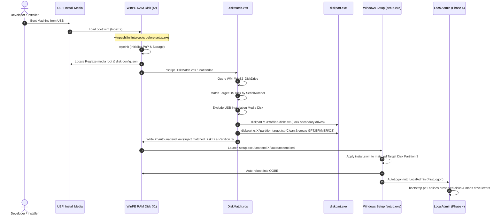

# Plan: Option B — Fully Unattended WinPE Deployment & Dynamic Partitioning

## 1. Executive Summary & Objectives

`reglaze` aims to provide declarative, disposable workstation provisioning from bare metal. While Option A (Safe Hybrid) isolates secondary disks and prompts the user at the Windows Setup drive selection screen, **Option B achieves true zero-touch, 100% unattended deployment**.

### Key Objectives:
1. **Zero User Interaction:** The machine boots from USB media and installs Windows completely hands-free from UEFI boot to interactive user logon.
2. **Dynamic Hardware Matching:** Detects the Target OS Disk in WinPE using multi-factor hardware attributes (Serial Number + Bus Type), eliminating dependence on ephemeral BIOS/NVMe disk index numbers.
3. **Pre-Setup Drive Isolation:** Automatically offlines and marks `readonly` all secondary, internal, and preserved disks **before** `setup.exe` runs, guaranteeing that Windows Setup cannot hijack existing secondary EFI partitions or overwrite data.
4. **Dynamic `autounattend.xml` Generation:** Automatically formats the target disk (GPT layout) and dynamically generates an answer file on `X:\autounattend.xml` with the exact matched `DiskID` and `PartitionID`.

---

## 2. Technical Challenge: Why WinPE Interception is Required

In standard Windows installation media, `sources\boot.wim` launches `X:\sources\setup.exe` immediately upon boot. 

- `setup.exe` parses `autounattend.xml` from the USB drive **into memory at startup**.
- `<RunSynchronousCommand>` in the `windowsPE` pass executes *after* `setup.exe` has already cached its configuration in memory.
- If `<ImageInstall><OSImage><InstallTo><DiskID>` is hardcoded to `0`, but WinPE enumerates the NVMe drive as Disk `1` or Disk `2`, setup fails immediately with an unrecoverable disk error.
- **Therefore, to achieve unattended dynamic partitioning, we must intercept WinPE *before* `setup.exe` launches.**

---

## 3. High-Level Architecture



---

## 4. Detailed Component Implementation Plan

### 4.1. WinPE Shell Hook (`winpeshl.ini`)
In `boot.wim` (Image 2: Windows Setup), the native shell launcher `winpeshl.exe` reads `X:\Windows\System32\winpeshl.ini`.

During `reglaze media` creation, `Build-Media.ps1` will service `sources\boot.wim` using DISM:
```ini
[LaunchApps]
"wpeinit.exe"
"cmd.exe", "/c X:\Reglaze\winpe-orchestrator.cmd"
```

### 4.2. WinPE Orchestrator (`winpe-orchestrator.cmd`)
Stages in `X:\Reglaze\winpe-orchestrator.cmd`:
1. **Hardware Initialization:** Wait for storage controllers to finish PnP enumeration.
2. **Media Discovery:** Scan drive letters `C:` through `Z:` to locate `\payload\disk-config.json` and `\autounattend.xml`.
3. **Invoke `DiskMatch.vbs` in Unattended Mode:**
   ```cmd
   cscript.exe //nologo "%MEDIA_DRIVE%\Reglaze\DiskMatch.vbs" ^
       /configFile:"%MEDIA_DRIVE%\payload\disk-config.json" ^
       /mediaLetter:"%MEDIA_DRIVE%" ^
       /outputPath:"X:\offline-disks.txt" ^
       /partitionScript:"X:\partition-target.txt" ^
       /templateXml:"%MEDIA_DRIVE%\autounattend.xml" ^
       /outputXml:"X:\autounattend.xml" ^
       /unattended:true
   ```
4. **Failsafe Check:**
   - If `DiskMatch.vbs` returns exit code `0`:
     - Run `diskpart.exe /s X:\offline-disks.txt`
     - Run `diskpart.exe /s X:\partition-target.txt`
     - Run `X:\sources\setup.exe /unattend:X:\autounattend.xml`
   - If `DiskMatch.vbs` returns non-zero (target disk serial not found or ambiguous):
     - Display loud red diagnostic message.
     - Drop into interactive console (`cmd.exe /k`) so the user can inspect disks manually without accidental data loss.

### 4.3. Enhancements to `DiskMatch.vbs` for Option B
The existing `DiskMatch.vbs` (implemented for Option A) already handles WMI queries, serial normalization, USB media exclusion, and secondary disk offlining. For Option B, two additional subroutines will be added:

1. **Target Disk Partition Script Generation (`X:\partition-target.txt`):**
   ```text
   select disk <TARGET_INDEX>
   clean
   convert gpt
   create partition efi size=260
   format quick fs=fat32 label="System"
   create partition msr size=16
   create partition primary
   shrink minimum=1000
   format quick fs=ntfs label="Windows"
   create partition primary
   format quick fs=ntfs label="Recovery"
   set id="de94bba4-06d1-4d40-a16a-bfd50179d6ac"
   gpt attributes=0x8000000000000001
   ```
2. **Answer File Generation (`X:\autounattend.xml`):**
   - Read template `autounattend.xml` using `MSXML2.DOMDocument` (or string replacement).
   - In `<ImageInstall><OSImage>`:
     - Set `<InstallTo><DiskID><TARGET_INDEX></DiskID><PartitionID>3</PartitionID></InstallTo>`.
     - Set `<WillShowUI>OnError</WillShowUI>`.
   - Save to `X:\autounattend.xml`.

### 4.4. `Build-Media.ps1` Servicing Steps
`Build-Media.ps1` will include an automated DISM servicing block when compiling media:
```powershell
# 1. Mount boot.wim (Index 2)
dism.exe /Mount-Wim /WimFile:"$TargetUsb\sources\boot.wim" /Index:2 /MountDir:"$TempMount"

# 2. Inject winpeshl.ini and orchestrator scripts
Copy-Item "$CompilerRoot\winpeshl.ini" "$TempMount\Windows\System32\winpeshl.ini" -Force
Copy-Item "$CompilerRoot\winpe-orchestrator.cmd" "$TempMount\Reglaze\winpe-orchestrator.cmd" -Force

# 3. Commit and unmount
dism.exe /Unmount-Wim /MountDir:"$TempMount" /Commit
```

---

## 5. Failure Recovery & Safety Mechanisms

1. **Serial Number Mismatch Guard:**
   If `DiskMatch.vbs` cannot match the target disk (e.g. firmware reported different serial formatting or disk was replaced):
   - **Never format Disk 0 blindly.**
   - Abort unattended setup immediately.
   - Launch `cmd.exe` with `diskpart` and `wmic` available, allowing the operator to select the drive manually.
2. **Preserved Disk Protection Guarantee:**
   Any disk whose serial number matches `preserved_disks` is unconditionally offlined and marked `readonly` before any partitioning command is issued.
3. **USB Media Preservation:**
   The physical disk index holding the active installation media is detected via WMI partition-to-logical-disk association and permanently excluded from all diskpart operations.

---

## 6. Phase 4 Handoff & Drive Letter Reconciliation

Once Windows Setup finishes applying the image and boots into `LocalAdmin`:
- `Set-ReglazeDriveLetters.ps1` runs in Step 1 of `Start-MachineBootstrap.ps1`.
- It enumerates all disks, identifies the preserved disks that were offlined in WinPE, and brings them back online (`Set-Disk -IsOffline $false -IsReadOnly $false`).
- Disks configured with `expected_mount: null` are intentionally left offline.
- Drive letters are mapped atomically, leaving the Google Drive stream letter (`G:`) available.

---

## 7. Migration Checklist from Option A to Option B

- [ ] Add `winpeshl.ini` template to `src/media/`.
- [ ] Add `winpe-orchestrator.cmd` to `src/compiler/`.
- [ ] Extend `DiskMatch.vbs` with `/unattended` switch to emit `X:\partition-target.txt` and `X:\autounattend.xml`.
- [ ] Add DISM `boot.wim` injection logic to `Build-Media.ps1` with an opt-in switch `-UnattendedWinPE` (allowing users to toggle between Option A and Option B).
- [ ] Add end-to-end VM integration test in Milestone 5 Hyper-V pipeline.

